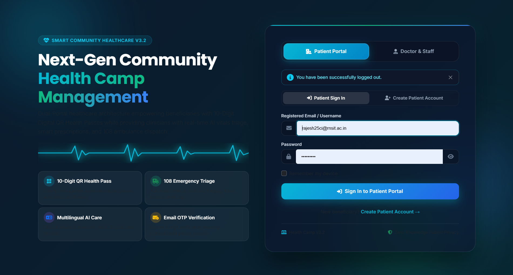
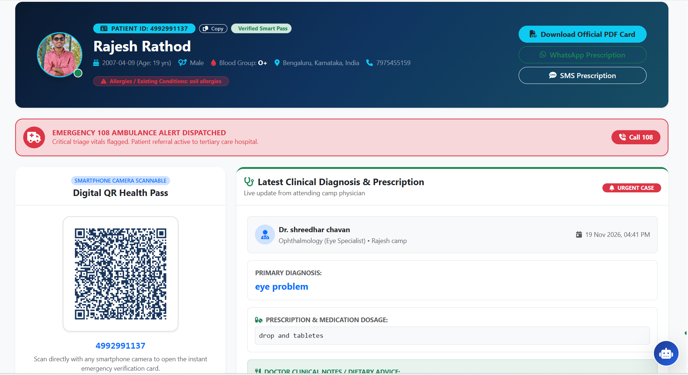
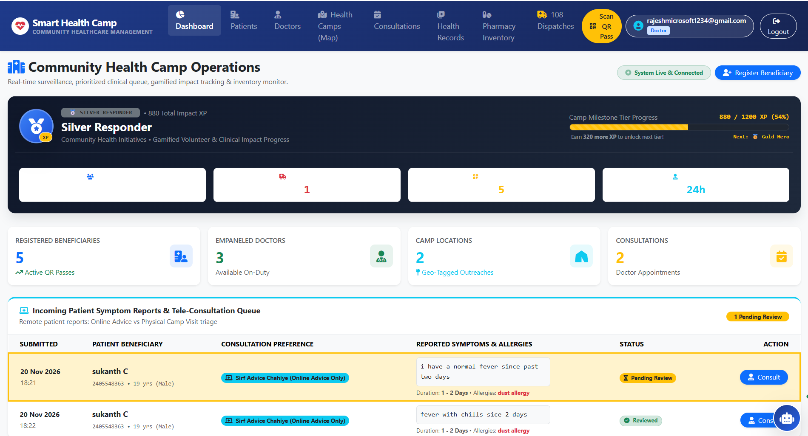
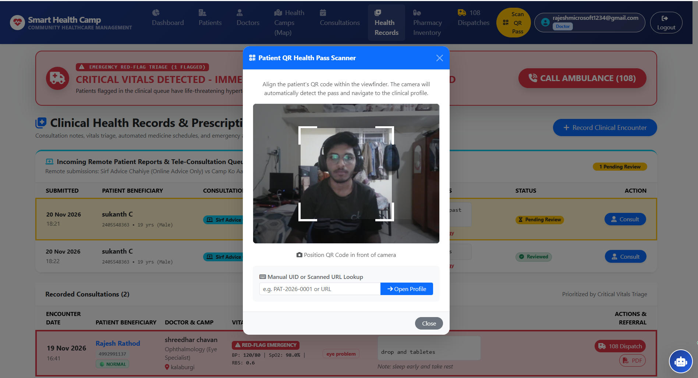
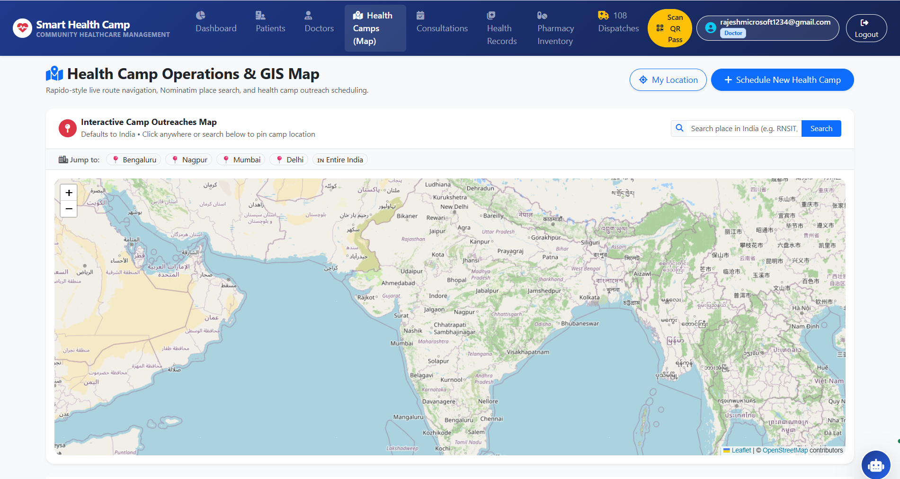

<div align="center">

# 🏥 Smart Community Health Camp & Tele-Consultation Platform

**Bridging Rural & Community Healthcare with Real-Time Tele-Triage, Automated Prescriptions, and Digital Health Passes**

[](https://health-camp-app.onrender.com)
[](https://www.python.org/)
[](https://flask.palletsprojects.com/)
[](https://ai.google.dev/)

🌐 **Live Production App:** [https://health-camp-app.onrender.com](https://health-camp-app.onrender.com)

<br/>



</div>

---

## 📖 Overview

**Smart Community Health Camp** is a full-stack digital healthcare and tele-consultation platform built to modernize medical outreach camps and remote doctor-patient consultations.

Traditional community health camps struggle with manual paper records, delayed follow-ups, and zero post-camp connectivity. This platform solves that end-to-end—enabling patients to register with **real-time Gmail SMTP OTP verification**, submit structured symptom reports for **Online Advice** or **Physical Camp Visits**, receive **instant live prescriptions**, download **QR-verified PDF health passes**, and get automated **SMS & WhatsApp medication alerts**.

---

## 📸 Platform Visual Showcase

<table>
  <tr>
    <td width="50%" align="center">
      <b>🧑‍⚕️ Patient Portal & Live Prescription Sync</b><br/><br/>
      
      <p><i>Submit symptoms (Online Advice vs Camp Visit) and view real-time diagnosis, tablet schedules & diet plans.</i></p>
    </td>
    <td width="50%" align="center">
      <b>🩺 Streamlined Doctor Triage & 1-Click Consult</b><br/><br/>
      
      <p><i>Urgency-tagged triage queue with adaptive consultation forms that auto-hide physical vitals for remote advice.</i></p>
    </td>
  </tr>
  <tr>
    <td width="50%" align="center">
      <b>📄 Verifiable QR Medical Pass (PDF)</b><br/><br/>
      
      <p><i>Instant downloadable PDF clinical summary with patient photo and scannable verification QR code.</i></p>
    </td>
    <td width="50%" align="center">
      <b>🗺️ Interactive India Health Camp Map</b><br/><br/>
      
      <p><i>Searchable geolocation map showing active community health camps with live turn-by-turn directions.</i></p>
    </td>
  </tr>
</table>

---

## 🏗️ End-to-End Clinical Workflow

```text
┌──────────────────────┐      ┌──────────────────────────┐      ┌───────────────────────────┐
│   1. PATIENT PORTAL  │      │     2. DOCTOR TRIAGE     │      │    3. INSTANT DELIVERY    │
├──────────────────────┤      ├──────────────────────────┤      ├───────────────────────────┤
│ • Gmail OTP Sign-Up  │ ───► │ • Priority Queue         │ ───► │ • Live Portal Sync        │
│ • Submit Symptoms    │      │   (Normal / Urgent)      │      │ • Morning/Afternoon/Night │
│ • Choose Mode:       │      │ • 1-Click Direct Consult │      │   Dosage + Diet Plan      │
│   - Online Advice    │      │ • Auto-Hidden Vitals     │      │ • Auto SMS & WhatsApp     │
│   - Camp Visit       │      │   for Remote Advice      │      │ • PDF Pass + QR Code      │
└──────────────────────┘      └──────────────────────────┘      └───────────────────────────┘